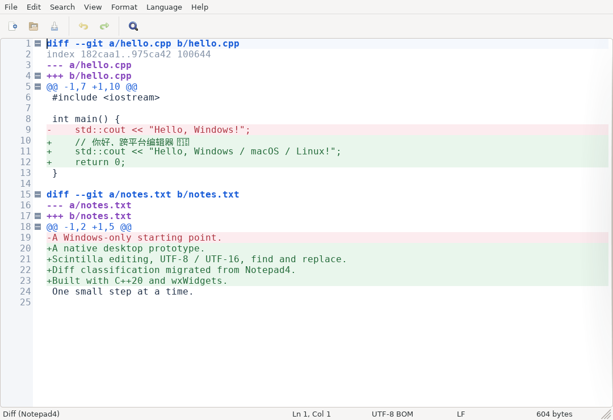

# Notepad

一个基于 **C++20、wxWidgets 和 Scintilla/wxStyledTextCtrl** 的跨平台文本编辑器原型，用来验证 Notepad4 的功能迁移和轻量桌面路线。

当前交付的是可独立构建的编辑器基础：窗口、文本编辑、文件读写、查找替换和语言着色。Notepad4 的 Diff 行分类逻辑作为首个有来源记录的迁移样本接入。完整 Notepad4 的所有功能及其修改版 Scintilla 尚未整体迁移。



## 原型范围

- 打开、保存 UTF-8 和带 BOM 的 UTF-16 文本。
- Scintilla 编辑区、行号、撤销/重做、选择、复制粘贴。
- C++、Python、JSON 等内置语法着色，以及迁移的 Diff 分类器。
- 查找与替换、自动换行、缩放、浅色/深色编辑区。
- 大文件模式与可重复生成的测试文件。
- 独立于 GUI 的文档 I/O 和 Diff 分类测试；三平台构建与 GUI smoke 测试流程。

首版以 Unicode 文本为范围：UTF-8（含可选 BOM）、带 BOM 的 UTF-16 LE/BE；暂不自动猜测 GBK 等旧编码。原始换行保持不变，也可从 Format 菜单主动转换。编码前后任一表示目前上限为 256 MiB；20 MiB 起，自动语言模式关闭高亮以减少加载工作，仍可手动选择语言。界面为英文，支持 Unicode 文件内容和路径。

保存采用同目录临时文件完成写入后再替换，失败时保留原文件；检测到文件在磁盘上变化时要求确认。首版不覆盖 POSIX ACL/扩展属性保留，且不直接保存到符号链接或只读目标。文件未成功保存前不会清除修改状态。

版本定位和验证结果以当前提交的源码、测试及 [Actions 记录](https://github.com/1298345095/Notepad/actions) 为准。CI 中的加载基准是运行器上的测量记录，不代表相对原版 Notepad4 的性能结论。中文输入法、真实桌面字体/DPI、剪贴板及大文件的实际使用体验仍应在目标机器上检查。

本机已经跑通核心测试和真实窗口 smoke；100 MiB 普通多行文件单次加载约 0.71 秒，10 MiB 超长行仍需约 3.29 秒。环境、内存峰值、测试范围和原始 JSON 见 [验证记录](docs/VALIDATION.md)。

## 获取运行包

打开 [Build and test](https://github.com/1298345095/Notepad/actions/workflows/build.yml)，选择成功的运行，在 Artifacts 下载对应平台包：

| Artifact | 内容 | 运行方式 |
|---|---|---|
| `Notepad-windows-x64` | ZIP，包含 `Notepad.exe` | 解压后启动 |
| `Notepad-macos-arm64` | ZIP，包含 `Notepad.app` | Apple Silicon Mac 上解压运行 |
| `Notepad-linux-x64` | Ubuntu 24.04 构建的 DEB | 使用 `sudo apt install ./notepad-prototype_*.deb` 安装依赖与应用，运行 `Notepad` |

Windows/macOS 的 CI 从固定源码构建并静态链接 wxWidgets；Windows 同时静态链接 MSVC 运行库。Linux DEB 声明其系统共享库依赖。macOS 原型包尚未进行 Developer ID 签名和公证。

## 本地构建

需要 CMake 3.24+ 和支持 C++20 的编译器。默认使用机器上安装的 wxWidgets 3.2+：

```sh
cmake -S . -B build -DCMAKE_BUILD_TYPE=Release
cmake --build build --config Release --parallel
ctest --test-dir build -C Release --output-on-failure
```

需要固定依赖时，添加 `-DNOTEPAD_FETCH_WX=ON`。它下载带完整第三方依赖的 wxWidgets 3.2.12 官方源码包并检查 SHA-256；首次构建需要网络。各平台准备、纯核心测试和打包命令见 [BUILDING.md](docs/BUILDING.md)。

## 检查实际运行

Linux 示例：

```sh
./build/Notepad --smoke-test --smoke-output "$PWD/smoke.json"
python3 tools/generate_fixture.py fixtures/10m.txt --size-mib 10
./build/Notepad --benchmark "$PWD/fixtures/10m.txt" --benchmark-output "$PWD/benchmark.json"
```

没有显示服务器时，使用 `xvfb-run -a` 启动。`--smoke-test` 验证基本编辑流程并输出 JSON；它不能代替真实输入法与桌面交互测试。基准文件生成器还支持 `--kind long-line`，用于单独观察超长行行为。

## 代码结构

| 位置 | 职责 |
|---|---|
| `src/App.cpp`、`src/MainFrame.*` | 应用入口、窗口和命令编排 |
| `src/EditorCtrl.*` | Scintilla 呈现与交互 |
| `src/DocumentIO.*` | 文件、编码与保存 |
| `src/DiffLexer.*` | 从 Notepad4 迁入的 Diff 分类逻辑 |
| `src/SmokeTest.*` | GUI 自动验证与测量入口 |
| `tests/` | 无显示环境也可运行的核心测试 |
| `tools/generate_fixture.py` | 确定性的 UTF-8 测试数据 |

来源：[Notepad4](https://github.com/zufuliu/notepad4)、[wxWidgets](https://github.com/wxWidgets/wxWidgets)、[Scintilla](https://www.scintilla.org/)。项目及迁入代码的许可与来源说明见仓库中的许可文件。
